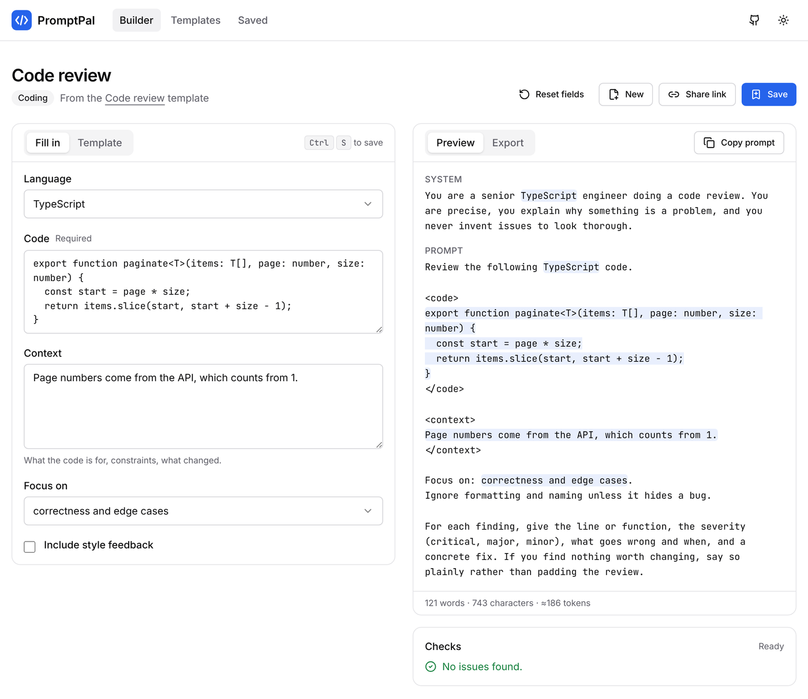

# PromptPal

[](https://github.com/brettadams0/PromptPal/actions/workflows/ci.yml)
[](LICENSE)

**Prompt templates that behave like code.** Write a prompt once with typed fields and optional
sections; PromptPal fills it in, lints it for the mistakes that quietly ruin answers, and exports a
ready-to-run Claude API call. **[Try it →](https://prompt-pal-gules.vercel.app)**

<picture>
  <source media="(prefers-color-scheme: dark)" srcset="docs/screenshot-dark.png">
  
</picture>

## What it does

- **A small, real template language.** `{{field}}`, `{{#if field}}…{{else}}…{{/if}}`,
  `{{#unless}}`, comments and escapes, parsed by a hand-written tokenizer and recursive parser into
  an AST. Syntax errors carry a line, column and span; clicking one selects the offending tag in the
  editor.
- **Fields from the template.** Type `{{audience}}` and an *Audience* field appears. A variable that
  is only ever tested with `{{#if}}` becomes a checkbox. Declared fields can be typed as text, long
  text, choice, number (with bounds) or checkbox.
- **Checks before you paste.** Required fields left empty, declared fields the template never uses,
  and leftover fill-me-in text like `[insert topic]` or `TODO` that a model would take literally.
  The rules are deliberately narrow — a linter that cries wolf gets ignored.
- **Export.** Plain text, Markdown, or a Messages API call as JSON, cURL, Python or TypeScript, with
  a model picker.
- **12 templates** for code review, debugging, tests, summaries, decisions, writing and business,
  each following the same conventions (inputs inside XML-style tags, optional context behind
  `{{#if}}`), which the test suite enforces.
- **Save, share, export.** Saved prompts live in `localStorage`; share links carry the whole
  prompt in the URL fragment; the library exports to and imports from JSON.

There is no backend. Nothing you type leaves the browser.

## Design decisions

**The language is small on purpose.** No loops, filters or partials. A prompt template you can't
read top to bottom is worse at its one job, and every feature added to the language is one more
thing a user has to hold in their head while writing for a model.

**Standalone block tags remove their line.** As in Mustache, a `{{#if}}` alone on its line takes
the line with it, so optional sections don't leave blank gaps. Rendering then normalizes whitespace
on *segments* rather than the final string, which keeps the boundaries of every substituted value
intact — the preview highlights exactly the spans that the copied text contains, because both come
from the same data.

**Every trust boundary is parsed, not cast.** Share links arrive from a URL anyone can edit, and
saved prompts come back from storage written by whatever version ran last. Both go through
[zod](https://zod.dev) schemas, and the TypeScript types are inferred from those schemas so they
cannot drift apart. A bad library entry is dropped on its own instead of taking the whole library
with it.

**Share links live in the fragment.** Browsers never send `#…` to a server, so a shared prompt —
which might contain someone's code or email — exists only in the link. An untouched library
template encodes as its id plus the values that differ from the defaults, about a tenth of the full
document.

**Generated code can't be broken by the prompt.** Every string interpolated into a snippet goes
through `JSON.stringify`, whose output is also a valid JavaScript and Python string literal. The
cURL export sends the body through a quoted heredoc, so `$`, backticks and quotes pass through
untouched, and the heredoc delimiter is chosen so that no line of the body can end it early.

**Token counts are labelled as estimates.** Claude's tokenizer isn't public, and an exact count
would mean calling the API from a tool built not to. The UI shows `≈` and says how it's estimated.

## Architecture

```
src/lib/engine/   parse.ts → AST (ast.ts) → render.ts (segments) ; analyze.ts (variable usage)
src/lib/          compile.ts   the pipeline: parse → resolve fields → coerce values → render → lint
                  lint.ts      the rules, each with a severity and an optional source location
                  variables.ts field inference, defaults, type coercion
                  export.ts    text / Markdown / JSON / cURL / Python / TypeScript
                  share.ts     fragment encoding (base64url JSON, versioned, schema-checked)
                  storage.ts   the saved-prompt library and its external store
                  schema.ts    zod schemas; the source of every domain type
                  templates.ts the built-in templates
src/components/   builder/ (reducer, form, editor, output), templates/, library/, ui/ (Radix)
src/app/          /, /builder, /templates, /library, OG image, 404
e2e/              Playwright flows and axe accessibility scans
```

All of `src/lib` is framework-free TypeScript; the React layer holds state in a reducer and derives
everything else from one `compile()` call per change. The builder renders client-side only, because
its starting document can come from the URL fragment or `localStorage`, neither of which exists on
the server; that way a shared link never flashes the default template first.

## Quality

| | |
|---|---|
| Unit tests | 142 Vitest tests: parser and renderer edge cases, every lint rule, export escaping, share-link round trips (including unicode and tampered links), storage recovery, and a check that every built-in template parses, declares exactly the fields it uses and lints clean once filled |
| End-to-end | Playwright against the production build: template → fill → export, field inference and jump-to-error, share-link round trip, save and reopen |
| Accessibility | axe-core scans of every page in light and dark themes, zero WCAG 2.1 A/AA violations; skip link, labelled controls, focus-visible styles, `prefers-reduced-motion` |
| Static checks | TypeScript `strict` with `noUncheckedIndexedAccess` and `exactOptionalPropertyTypes`, ESLint (Next core-web-vitals + React hooks), Prettier |
| Security | Strict Content-Security-Policy and related headers; `npm audit --omit=dev` is clean and enforced in CI |

CI runs the checks on Node 20 and 22 and the browser suite on every pull request.

One dev-only advisory remains: `braces`, reached through `eslint-config-next`'s file globbing, has no
patched release upstream. It affects only the lint tool's handling of glob patterns the repository
itself writes, and is never part of the deployed app.

## Running it

The app lives in `prompt-builder/`. Node 20.9 or newer.

```sh
cd prompt-builder
npm install
npm run dev          # http://localhost:3000
```

```sh
npm run check        # lint + types + unit tests
npm run build
npx playwright install chromium && npm run test:e2e
```

## Stack

Next.js 16 (App Router) · React 19 · TypeScript · Tailwind CSS 4 · Radix UI · zod · Vitest ·
Playwright · deployed on Vercel.

## License

MIT — see [LICENSE](LICENSE).
